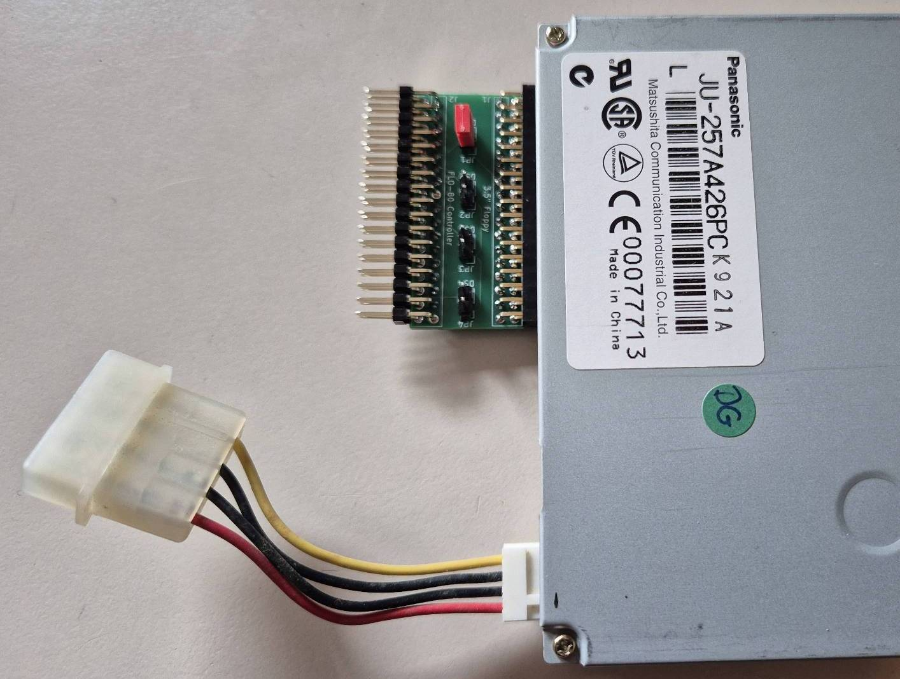

# Adapter-Platinen für den Gehäuseeinbau bzw. den einfacheren Anschluss von Laufwerken

* Der **MC_CPM_Floppyadapter** ist ein kleine Platine, mit dem man bis zu vier 3 1/2" Laufwerke ohne gedrehtes Kabel am FLO-Controller des MC CP/M-Computer betreiben kann. Auch gemischt mit 5 1/4" Laufwerken.

    

* **Floppy-Board-Rückwand** ist eine Platine, die den 34 und der 50-poligen Floppy-Anschluss auf der Rückseite eines Systemgehäuses herausführt. Ein passende Halterung findet man im Order 3D-Druck.

    

Bei Gelegenheit werde ich die Projekte umbenennen und sinnvolle Namen vergeben. ;-)
